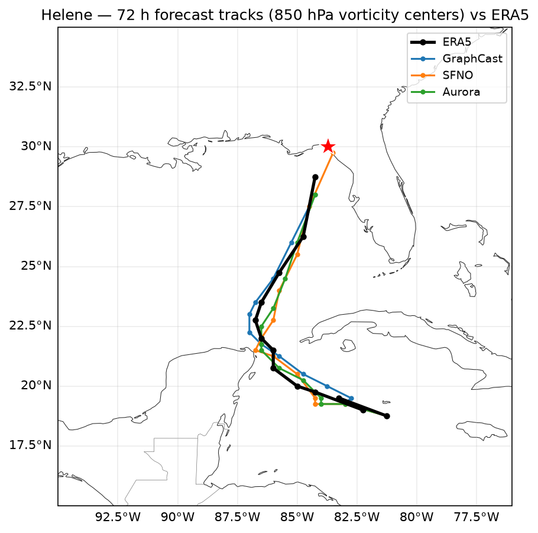
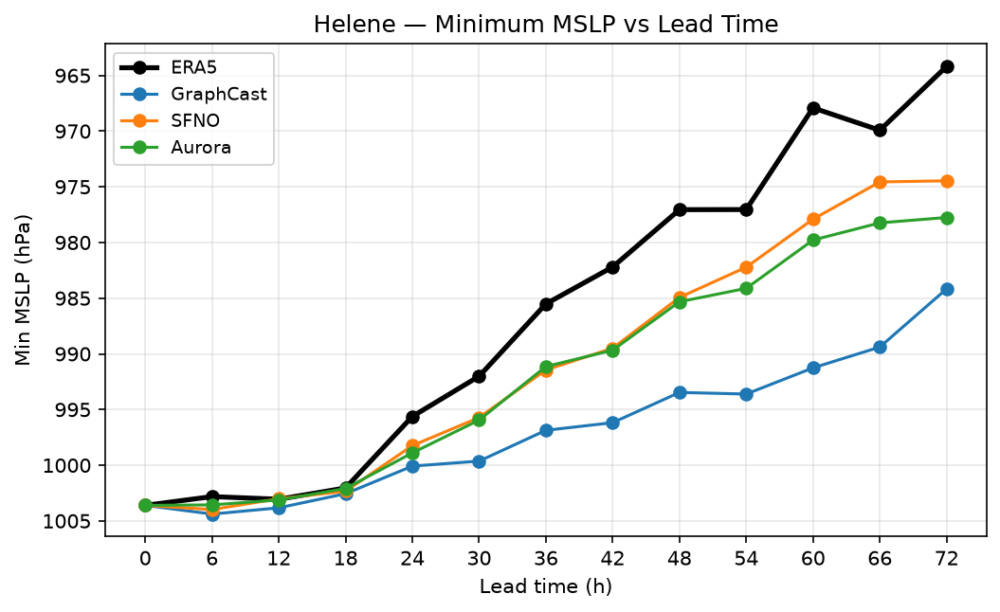
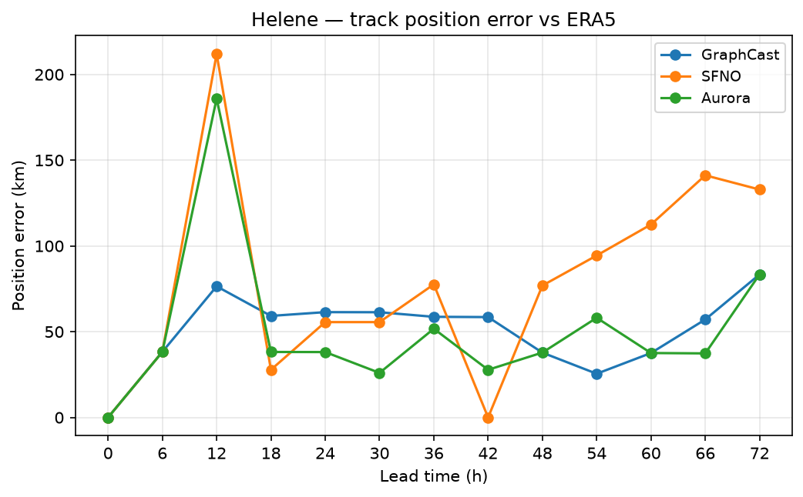

# Hurricane Helene — AI Weather Model Track & Intensity Verification



Three AI weather models — Google DeepMind's GraphCast (operational version), NVIDIA's SFNO and Microsoft's Aurora — forecast Hurricane Helene (Florida Big Bend landfall, 2024-09-27) three days ahead, all started from the same ERA5 state. Storm tracks and intensities are extracted from the model fields and scored against ERA5, using [NVIDIA Earth2Studio](https://github.com/NVIDIA/earth2studio).

## Results at a glance

Position error is the great-circle distance between a model's storm center and the ERA5 storm center; intensity error is the difference in minimum mean sea level pressure. ERA5 is a 0.25° reanalysis that smooths storm cores, so intensity errors measure agreement with ERA5, not with best-track pressure.

**Vorticity-center tracker: mean errors over the 72 h forecast**

<!-- helene_forecast_comparison_metrics:START -->
_Filled in after the verified run._
<!-- helene_forecast_comparison_metrics:END -->

**Vorticity-center tracker: error by lead hour**

<!-- helene_forecast_comparison_lead_errors:START -->
_Filled in after the verified run._
<!-- helene_forecast_comparison_lead_errors:END -->

**Wu–Duan tracker (SFNO and Aurora)**

<!-- helene_forecast_comparison_wuduan_metrics:START -->
_Filled in after the verified run._
<!-- helene_forecast_comparison_wuduan_metrics:END -->



*Intensity: minimum mean sea level pressure of each model against ERA5 over the 72 h forecast.*



*Track error: distance between each model's storm center and the ERA5 center at every lead hour.*


*Wu–Duan tracker: SFNO and Aurora tracks against the ERA5 track, selected out of all storms the tracker detects.*

## Models and data

| Model | Developer | Initial condition | Tracker |
|---|---|---|---|
| GraphCast (operational) | Google DeepMind | ERA5 (ARCO), same initial state as the other models | vorticity + MSLP |
| SFNO | NVIDIA | ERA5 (ARCO) | both trackers |
| Aurora | Microsoft | ERA5 (ARCO) | both trackers |
| ERA5 | ECMWF reanalysis | — | reference (tracked by both trackers) |

Earth2Studio asks users to familiarize themselves with the licence restrictions of the GraphCast checkpoints before using them; see the [WeatherNext repository](https://github.com/google-deepmind/weathernext) (where GraphCast is called WeatherNext 1-Graph), the [arXiv paper](https://arxiv.org/abs/2212.12794) and the [Science paper](https://www.science.org/doi/10.1126/science.adi2336).

## Quick start

Requires Python 3.12, [uv](https://docs.astral.sh/uv/), and an NVIDIA GPU with about 48 GB of VRAM (developed and tested on an L40).

```bash
git clone https://github.com/ChristianByars/Hurricane-Forecasts.git
cd Hurricane-Forecasts
uv sync
uv run python -m ipykernel install --user --name hurricane-forecasts --display-name "hurricane-forecasts"
```

`uv sync` expects a prebuilt torch-harmonics wheel in a `wheels/` folder; see [docs/environment.md](docs/environment.md).

Open a notebook in JupyterLab and select the **hurricane-forecasts** kernel, then run all cells.

## Notebooks

<!-- RUNS:START -->
_Runtime and GPU memory are filled in after the verified run._
<!-- RUNS:END -->

| Notebook | Tracker | Models |
|---|---|---|
| `helene_forecast_comparison.ipynb` | Vorticity center and minimum MSLP | GraphCast, SFNO, Aurora |
| `helene_forecast_comparison_wuduan.ipynb` | Wu–Duan tracker (`TCTrackerWuDuan`) | SFNO, Aurora |

## Repository layout

```text
helene_forecast_comparison.ipynb         vorticity/MSLP tracker: GraphCast, SFNO, Aurora
helene_forecast_comparison_wuduan.ipynb  Wu–Duan tracker: SFNO, Aurora
metrics.py                               great-circle distance and intensity-error helpers
tc_skill.py                              track and lead-hour skill tables
tests/                                   unit tests for metrics.py and tc_skill.py
docs/images/                             figures shown in this README
docs/results/                            CSV metric tables written by the notebooks
docs/environment.md                      pinned versions and install notes
```

## Environment notes

Pinned versions, install caveats, and fixes are in [docs/environment.md](docs/environment.md).

## References

- [NVIDIA Earth2Studio](https://github.com/NVIDIA/earth2studio) and its [documentation](https://nvidia.github.io/earth2studio/)
- [uv](https://docs.astral.sh/uv/)
