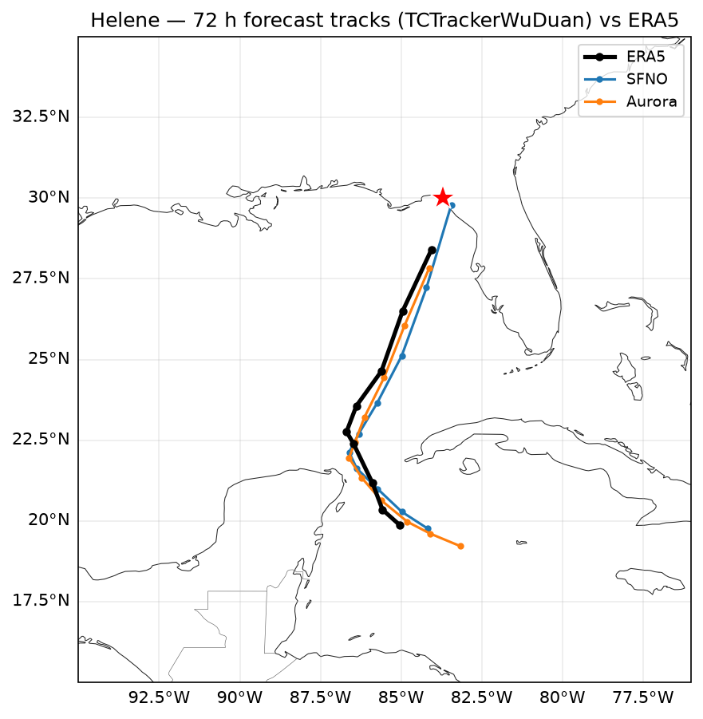
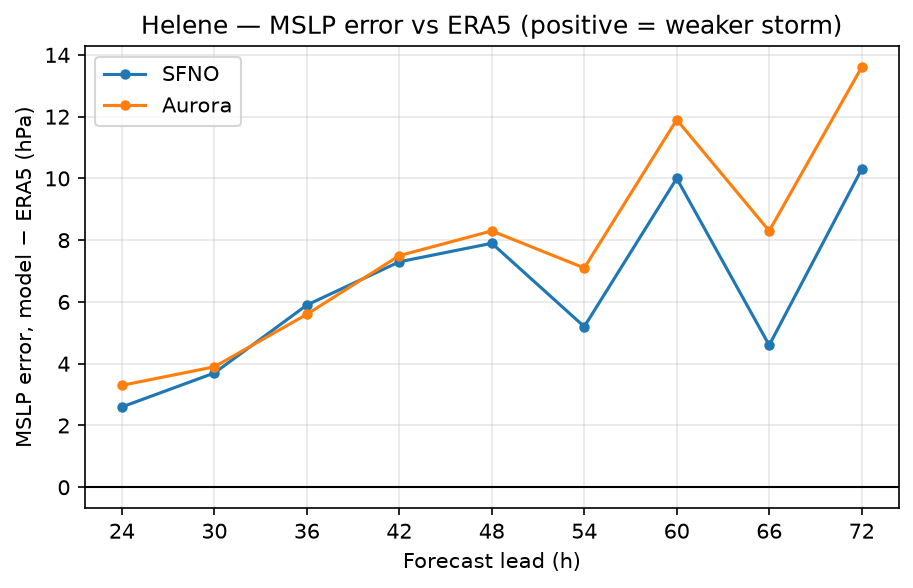

# Hurricane Helene — AI Weather Model Track & Intensity Verification



*SFNO and Aurora tracks against the ERA5 track. The Wu–Duan tracker detects every storm on the globe, and Helene's path is selected inside a regional box.*

Two AI weather models — NVIDIA's SFNO and Microsoft's Aurora — forecast Hurricane Helene (Florida Big Bend landfall, 2024-09-27) three days ahead, both started from the same ERA5 state. Storm tracks and intensities are extracted from the model fields with the Wu–Duan cyclone tracker in [NVIDIA Earth2Studio](https://github.com/NVIDIA/earth2studio) and scored against ERA5.

## Results at a glance

Position error is the great-circle distance between a model's storm center and the ERA5 storm center. MSLP error is the model's minimum mean sea level pressure inside the tracker's storm box minus ERA5's, so a positive MSLP bias means the model's storm is shallower than ERA5's. ERA5 is a 0.25° reanalysis that smooths storm cores, so intensity errors measure agreement with ERA5, not with best-track pressure.

**Mean errors over the scored leads (24–72 h)**

<!-- helene_forecast_comparison_wuduan_metrics:START -->
| Model | Position error, mean (km) | Position error, max (km) | MSLP bias (hPa) | MSLP RMSE (hPa) |
|---|---|---|---|---|
| SFNO | 76.1 | 164.9 | 6.39 | 6.87 |
| Aurora | 42.1 | 65.3 | 7.71 | 8.34 |
<!-- helene_forecast_comparison_wuduan_metrics:END -->

**Error by forecast lead hour**

<!-- helene_forecast_comparison_wuduan_lead_errors:START -->
| Lead (h) | SFNO position error (km) | SFNO MSLP error (hPa) | Aurora position error (km) | Aurora MSLP error (hPa) |
|---|---|---|---|---|
| 24 | 47.1 | 2.6 | 26.6 | 3.3 |
| 30 | 73.0 | 3.7 | 32.4 | 3.9 |
| 36 | 69.5 | 5.9 | 37.3 | 5.6 |
| 42 | 32.8 | 7.3 | 51.0 | 7.5 |
| 48 | 39.3 | 7.9 | 45.4 | 8.3 |
| 54 | 66.0 | 5.2 | 47.3 | 7.1 |
| 60 | 82.9 | 10.0 | 24.0 | 11.9 |
| 66 | 109.2 | 4.6 | 49.6 | 8.3 |
| 72 | 164.9 | 10.3 | 65.3 | 13.6 |
<!-- helene_forecast_comparison_wuduan_lead_errors:END -->

Leads before the tracker first detects Helene in ERA5 are not scored, which is why the lead-hour table starts at 24 h.



*MSLP error against ERA5 by lead time. A positive value means the model's storm is weaker than ERA5's; both models are weaker at every lead.*

## Models and data

| Model | Developer | Initial condition |
|---|---|---|
| SFNO | NVIDIA | ERA5 (ARCO) |
| Aurora | Microsoft | ERA5 (ARCO) |
| ERA5 | ECMWF reanalysis | — (the reference, tracked the same way) |

## Quick start

Requires Python 3.12, [uv](https://docs.astral.sh/uv/), and an NVIDIA GPU (developed and tested on an L40 with 48 GB; the table under *Notebooks* lists each notebook's peak GPU memory).

```bash
git clone https://github.com/ChristianByars/Hurricane-Forecasts.git
cd Hurricane-Forecasts
uv sync
uv run python -m ipykernel install --user --name hurricane-forecasts --display-name "hurricane-forecasts"
```

`uv sync` expects a prebuilt torch-harmonics wheel in a `wheels/` folder; see [docs/environment.md](docs/environment.md).

Open `helene_forecast_comparison_wuduan.ipynb` in JupyterLab and select the **hurricane-forecasts** kernel, then run all cells.

## Notebooks

<!-- RUNS:START -->
| Notebook | Runtime | Peak GPU memory (GiB) |
|---|---|---|
| helene_forecast_comparison_wuduan.ipynb | 3 min | 32.3 |
<!-- RUNS:END -->

`helene_forecast_comparison_wuduan.ipynb` runs SFNO and Aurora from the ERA5 state, tracks both with `TCTrackerWuDuan`, and writes the tables above to `docs/results/`.

## Repository layout

```text
helene_forecast_comparison_wuduan.ipynb  Wu–Duan tracker: SFNO and Aurora against ERA5
metrics.py                               great-circle distance, intensity error and area-weighted grid metrics
tc_skill.py                              track and lead-hour skill tables
tests/                                   unit tests for metrics.py and tc_skill.py
docs/images/                             figures shown in this README
docs/results/                            CSV metric tables written by the notebook, and runs.csv (runtime and peak GPU memory from the verified run)
docs/environment.md                      pinned versions and install notes
```

## Environment notes

Pinned versions, install caveats, and fixes are in [docs/environment.md](docs/environment.md).

## References

- [NVIDIA Earth2Studio](https://github.com/NVIDIA/earth2studio) and its [documentation](https://nvidia.github.io/earth2studio/)
- [uv](https://docs.astral.sh/uv/)
